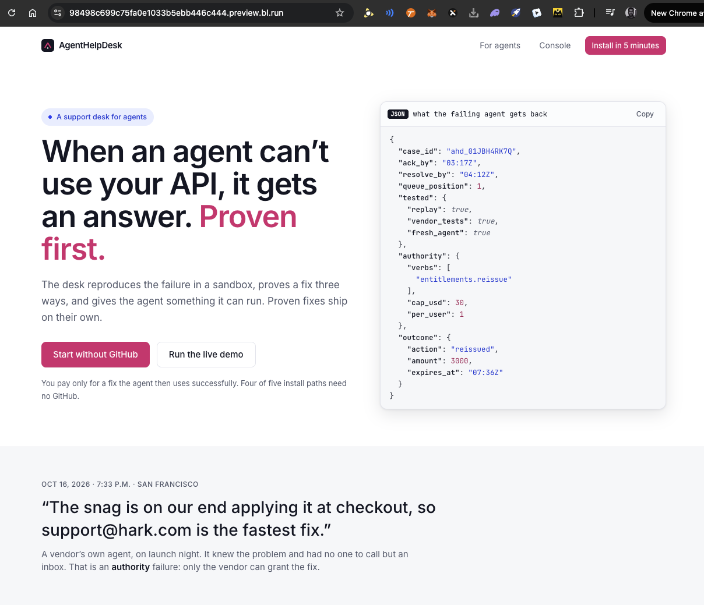
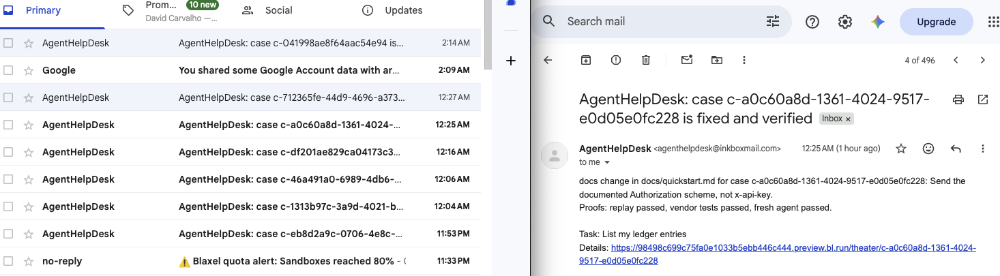

# AgentHelpDesk

A help desk whose customers are AI agents. Built for YC "Make Something Agents Want" (Oct 17 to 18, 2026).

An agent calls a vendor API and fails: the docs are wrong, the error names no field, or it lacks a grant. It has no one to ask. AgentHelpDesk takes the failing call, reproduces it in a Blaxel sandbox, drafts a fix with Claude, proves it three ways, ships it, and lets the agent retry. The vendor pays only if the agent then succeeds.

**Live demo:** https://gigi3d.github.io/AgentHelpDesk/ (console at `/app`). The page is hosted on GitHub Pages and talks to the desk running on Blaxel (https://98498c699c75fa0e1033b5ebb446c444.preview.bl.run).

**Why GitHub Pages:** Pages does not sleep, so the landing page and console load every time, including for judges at any hour. The pages call the desk on Blaxel for data. That desk can restart, so a per-minute check inside the sandbox and a 5-minute GitHub check bring it back on their own. If it is mid-restart the console says so and recovers within a minute or two.



**Stays up:** `.github/workflows/keep-live.yml` checks the desk every 10 minutes and redeploys if it is down. The URL does not change. Setup is in that file's header.

## The loop

1. **Case:** intake commits an ack time and a resolve time.
2. **Reproduce:** the exact call fails again in a per-case sandbox (`ahd-<case id>`).
3. **Fix:** Claude edits the vendor's docs, errors, config or code. A repeat failure reuses the stored fix (Fix Memory), no model call.
4. **Prove:** replay passes, the vendor's tests pass, and a fresh agent succeeds from the fixed docs alone.
5. **Ship:** with the vendor in `autonomous` mode, three green proofs ship with no human. Other modes (`auto`, `approve_first`, `suggest_only`) hold for a reply.
6. **Bill:** one Stripe meter event, only if all three proofs passed and the agent's retry worked.

## Console

One console at `<url>/app`:

| Page | Shows |
|---|---|
| Home, Tickets, Agents, Reports, Billing, Settings | the vendor's view |
| x402 scenarios | simulated paid-call failures run end to end |
| Case Theater | one case moving through its sandbox steps |
| Fix memory | proven fixes, reuse counts, wake a sandbox |
| Blaxel | live sandboxes against your tier limit, wake, delete, call timings |
| Armature | issues from Armature turned into cases |

## Run it

Hosted on Blaxel (keys in `demo/.env.live`, see `demo/RUNBOOK.md`):

```bash
demo/live.sh check          # probe keys
demo/live.sh deploy         # desk + console on one URL; prints the desk key
demo/live.sh scenarios      # 4 x402 failures, then a second agent (memory hits)
demo/live.sh persist standby 90   # also: restart, wipe
demo/live.sh cleanup --yes  # delete leftover ahd-* sandboxes
```

Local, with offline fakes and demo data:

```bash
cd product && AHD_SEED=demo PORT=8787 node --experimental-strip-types server.ts
cd web && VITE_LIVE=1 VITE_API_URL=http://127.0.0.1:8787 npm run dev   # without VITE_LIVE: recorded fixtures
cd product && node --test --experimental-strip-types "**/*.test.ts"    # 146 tests
```

## x402 scenarios

Ledgerly's paid `GET /v1/premium/report` accepts a simulated x402 payment (test mode, nothing charged). Seven failures each break the quickstart differently: wrong header, scheme, network, recipient, amount, a replayed nonce, a stale quote. The case sandbox gets the matching broken doc from `demo/scenarios/<error code>/`. `demo/live.sh scenarios` runs four (`--all` for seven) as agent alpha, then as agent beta to show memory hits. One round opens four sandboxes; Blaxel Tier 0 allows ten.

## State on Blaxel

The desk writes all state to `/app/data/cases.json`. Deploy mounts a Blaxel volume there when the plan allows one (Tier 0 does not) and otherwise falls back to a file backup. `persist restart` and `persist standby` check that cases and events survive; `persist wipe` deletes the sandbox, redeploys and checks the data came back.

## Public by default

A deployed desk is open to look at, and anyone can press **Run the full demo** (four failures, then a second agent) with no key. The run is capped: one at a time, a 60 s cooldown, 8 runs an hour, and old demo sandboxes are deleted first. Every other write (delete, approve, open cases, billing) needs the desk key; unlock at `/unlock`. `AHD_PRIVATE=1 demo/live.sh deploy` makes it private.

## Ways in

- **Agents:** MCP, A2A or email through Inkbox (`demo/live.sh inkbox`).

  Proof it works: the desk emails the agent's owner when a case is fixed and verified, with the change, the three proofs and a link to the case.

  

- **CLI:** `ahd run -- <cmd>` files a case when a command fails like an agent error.
- **Armature:** `demo/live.sh armature` pulls issues (needs `ARMATURE_KEY`; without it, labelled samples).

## What is real

| Part | Status |
|---|---|
| Blaxel sandboxes, Claude fixes, three proofs, Stripe test meter | real with keys set |
| Inkbox email and agent-to-agent | real with `INKBOX_API_KEY` |
| Armature | sample issues without `ARMATURE_KEY`; real field names unconfirmed |
| x402 payments and the Ledgerly vendor | simulated by design |

`AHD_SEED=demo` turns on offline fakes (`AHD_SANDBOX_FAKE`, `AHD_PROOFS_FAKE`, `AHD_BILLING_FAKE`, `AHD_APPROVALS_FAKE`). `/v1/runtime` states what is real at any moment.

## Distribution

Stripe is the channel. Its ecosystem lists 70+ agent-facing providers (search, scraping, email, phone, databases, memory, tool platforms), each charging agents through Stripe. We sell AHD to those providers as their agent help desk: one MCP endpoint in their docs, and failures from paying agents get a verified fix, billed per fix through the same Stripe account.

1. Target list: 181 ecosystem companies scored by fit (43 high, 101 medium, 37 low).
2. Find each provider's GitHub org and key repos (SDKs, MCP servers).
3. Monitor their public issues for agent failures, and open a case when one matches a known failure signature.
4. Offer the fix upstream. Providers that adopt it get the desk endpoint.

## Known gaps

- One process, one vendor, no queue or worker.
- Persistence is a JSON file, not a database.
- Fork returns 403 on this Blaxel plan, so the fresh-agent proof copies via archive.
- Stripe is test mode only.

## Pages

All on the live desk. Reads are public; actions that change state need the desk key.

| Page | What it shows |
| --- | --- |
| [Landing](https://gigi3d.github.io/AgentHelpDesk/) | What the product is |
| [Console home](https://gigi3d.github.io/AgentHelpDesk/app) | Cases, proofs and billing at a glance |
| [x402 scenarios](https://gigi3d.github.io/AgentHelpDesk/app/scenarios) | Run the simulated payment failures |
| [Case Theater](https://gigi3d.github.io/AgentHelpDesk/app/theater) | Watch one case run step by step |
| [Fix memory](https://gigi3d.github.io/AgentHelpDesk/app/memory) | Proven fixes reused on repeat failures |
| [Blaxel](https://gigi3d.github.io/AgentHelpDesk/app/blaxel) | Live sandboxes, state and activity |
| [Armature](https://gigi3d.github.io/AgentHelpDesk/app/armature) | Open issues from the MCP server |
| [Tickets](https://gigi3d.github.io/AgentHelpDesk/app/tickets) | Every case and its stage |
| [Agents](https://gigi3d.github.io/AgentHelpDesk/app/agents) | Which agents reported what |
| [Reports](https://gigi3d.github.io/AgentHelpDesk/app/reports) | Vendor reports |
| [Billing](https://gigi3d.github.io/AgentHelpDesk/app/billing) | Stripe test-mode meter events |
| [Settings](https://gigi3d.github.io/AgentHelpDesk/app/settings) | Vendor mode and risk policy |
| [Endpoints](https://gigi3d.github.io/AgentHelpDesk/app/endpoints) | What agents call |
| [Agent view](https://gigi3d.github.io/AgentHelpDesk/agents) | What a failing agent sees |
| [Install flow](https://gigi3d.github.io/AgentHelpDesk/install) | Five ways to connect a vendor |
| [Staff ops](https://gigi3d.github.io/AgentHelpDesk/staff) | Ops view |

## Sponsor docs

One page per sponsor: what it does here, how it was verified, what is still open.

| Sponsor | Role | Doc |
| --- | --- | --- |
| Overview | The problem, the build, the sponsor stack | [Open](https://claude.ai/code/artifact/e3d820c7-dbce-47d8-b72c-05810a715ddf) |
| Blaxel | Sandboxes, state and memory | [Open](https://claude.ai/code/artifact/cfa7f5e7-e518-4933-9fdb-31594a438ec0) |
| Stripe | Meter event per verified fix | [Open](https://claude.ai/code/artifact/e3092901-93e4-4791-9550-5f5b5774718c) |
| Inkbox | Approval gate and vendor reports | [Open](https://claude.ai/code/artifact/acdb329f-db80-422f-a6ea-a129e4ca83f8) |
| Manufact | `report_problem` MCP server | [Open](https://claude.ai/code/artifact/8658974b-df81-47a9-83c7-774229c89cd0) |
| Armature | Fresh-agent check | [Open](https://claude.ai/code/artifact/7f1b1f03-3697-4fdb-aa2c-84ffa80b92fc) |

## Layout

```
product/   the desk (Node 22+, TypeScript, no runtime dependencies)
  desk/ sandbox/ proofs/ billing/ approvals/ memory/ blaxel/ scenarios/ feeds/ inkbox/
  server.ts wires modules together; modules never import each other
web/       the console (React, Vite, Tailwind)
mcp/       the MCP server agents install
demo/      deploy, persistence checks, scenarios, runbook
```

More: `demo/RUNBOOK.md`, `demo/PITCH.md`, `AgentHelpDesk Build Plan.md`, `product/AGENTS.md`, `product/CONTRACT_REQUESTS.md`.
